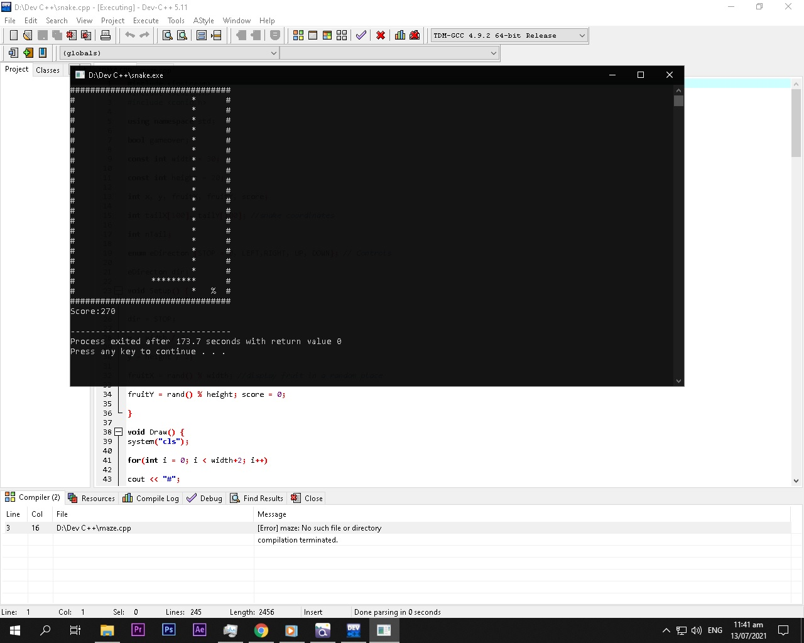

# Snake Game — C++

A classic console-based Snake Game developed in C++ in 2019-2021 using Dev-C++, now migrated to Visual Studio Code and compiled with GCC/G++.

## About the Project

This project is a terminal-based implementation of the classic Snake Game. The player controls a snake, collects food to increase their score, and attempts to avoid collisions.

The project was originally developed in 2021 as a C++ programming exercise and later migrated to a modern development environment.

## Technologies Used

- **Programming Language:** C++
- **Original IDE:** Dev-C++
- **Current Editor:** Visual Studio Code
- **Compiler:** GCC/G++ 16.2.0 (MSYS2 UCRT64)
- **Platform:** Windows Console

## Features

- Console-based game board
- Snake movement and keyboard input
- Random food generation
- Score tracking
- Snake growth when collecting food
- Collision-based game-over mechanics

## Requirements

- Windows operating system
- GCC/G++ compiler with Windows console support
- Terminal or command-line environment

## Installation and Setup

### 1. Clone the repository

```bash
git clone https://github.com/YOUR_USERNAME/Snake-Game-CPP.git
```

### 2. Navigate to the project directory

```bash
cd Snake-Game-CPP
```

### 3. Compile the source code

```bash
g++ -std=c++17 snake.cpp -o snake.exe
```

### 4. Run the game

In PowerShell:

```powershell
.\snake.exe
```

## Gameplay

Control the snake using the keyboard. Collect food to increase your score while avoiding collisions.

## Project Background

Originally created in 2021, this project represents my early experience with C++ programming, console applications, and fundamental programming concepts.

The project was successfully migrated from Dev-C++ to Visual Studio Code in 2026.

## Author

**Christian Philip T. Pagalan**

Computer Engineering Student | Software Development Enthusiast

## License

No open-source license has been assigned yet. All rights are reserved unless a license is added.

## Gameplay Preview

